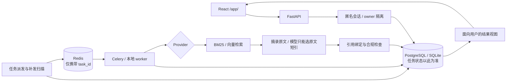

# MedCite

> 基于公开证据的医疗信息辅助分析原型：每条结论都能追溯到原文与来源，证据不足时明确弃答。

[](https://github.com/control-coder/medcite/actions/workflows/ci.yml)


> [!IMPORTANT]
> 本项目是工程原型，只处理公开资料与模拟输入，不提供诊断、处方或治疗建议，也不接收真实患者数据。

## 项目简介

用户提交一个健康相关问题，系统在公开语料中检索证据，由后台任务完成检索、生成、审核与结果投影，最终只展示能关联到原文片段的内容，并附上来源链接、局限与风险提示。找不到支持的证据时，系统返回“证据不足”，而不是生成看似确定的回答。

- **可追溯引用**：每条展示内容都绑定到本次检索返回的原文片段；无引用的内容不会出现在结果页。
- **失败与拒答**：检索不到内容时不调用模型，直接拒答；模型改写了原文、引用了不存在的片段、格式错误或输出被截断时，一律拒绝。
- **任务一致性**：任务状态以数据库为准，消息队列只负责通知 worker；消息重复投递、消息没发出去、worker 中途挂掉、任务取消后才到的写入，都有处理并有测试。

## 功能特性

- React + TypeScript 前端四个页面：咨询提交、任务进度、结果与证据、历史记录；刷新可恢复同一任务。
- FastAPI 单体加独立 worker 进程，支持 SQLite 本地演示，以及 PostgreSQL + Redis/Celery 服务模式。
- 任务状态机；幂等键去重；乐观锁；worker 领取任务后在租约内独占并定期续约；各阶段结果落库，中断后可续跑；定时扫描补发“任务已保存但消息没发出”的情况。
- 服务端签发匿名会话，每个用户只能访问自己的数据；访问别人的或不存在的数据一律返回 404。
- 三种显式运行模式，互不静默切换：`fake_offline`（固定证据与输出，无依赖演示流程）、`retrieval_mock`（真实检索加固定规则摘录原文，默认演示，无需模型或密钥）、`mimo_grounded`（真实 LLM 只能选择完整原文短引，有预算限额）。
- 检索方案四选一，都要显式配置：BM25（`configs/application.yaml`，默认，中文按相邻两字切分）；向量检索（`application_dense.yaml`，固定版本 bge-small-zh，只读本地缓存）；BM25 加问题改写（`application_rewrite.yaml`）；BM25 加检索智能体（`application_agent.yaml`）。后三种搭配 `mimo_grounded` 时，输出不合格会带原因重试一次。选型依据见 [架构与取舍](docs/architecture.md)。
- 真实模型调用有预算账本：先扣额度再发请求，失败不退还，重启不重置，不跟随重定向。
- 评测代码在 `eval/`：模型调用记录入库，CI 零网络回放，并运行回归门槛。

## 界面截图

截图由浏览器自动测试生成，使用默认的 BM25 加固定规则摘录，重新生成的方法见 [开发与运行](docs/development.md)。

**结果与证据页**：每条摘录都标明“检索摘录，不代表问题已获解答”，右侧列出原始来源并可点开原文。


**手机宽度下的拒答**：问题与语料无关时检索不到证据，页面显示“证据不足”，不给出结论。


## 架构



设计取舍、一致性保证与已知限制见 [docs/architecture.md](docs/architecture.md)。

## 快速开始

环境要求：Python 3.11、Node.js 20.19+。默认演示不需要 Docker、模型下载或 API Key。

```bash
# 1. 安装依赖（推荐使用独立的 conda 环境）
conda env create -f environment.yml
conda activate medidiag
python -m pip install -e ".[dev]"
npm ci --prefix frontend
npm run build --prefix frontend

# 2. 使用独立的演示数据库并完成迁移
mkdir -p .cache/demo
export DATABASE_URL="sqlite:///./.cache/demo/public-demo.db"
export HF_HUB_OFFLINE=1 TRANSFORMERS_OFFLINE=1
python -m alembic upgrade head

# 3. 启动（API + 本地 worker 线程）
python -m medidiag.cli demo --provider retrieval_mock --app-config configs/application.yaml --port 8400
```

打开 <http://127.0.0.1:8400/app/>，点击“填入公开检索示例”并提交。Windows PowerShell 下用 `$env:DATABASE_URL = "..."` 设置环境变量。PostgreSQL + Redis/Celery、真实模型模式与排障见 [docs/development.md](docs/development.md)。

## 测试

```bash
ruff check .
mypy src
python -m pytest -q
python scripts/verify_offline.py --provider retrieval_mock --browser   # 端到端：独立 API/worker 加浏览器
```

CI 在每次推送到 `main` 和每个 Pull Request 上运行三个作业：`check`（ruff、mypy 严格模式、pytest）、`eval-regression`（零网络回放模型调用记录并运行回归门槛，误答必须为 0，见 [examples/rag_regression](examples/rag_regression/README.md)）、`e2e`（真实 API、独立 worker、Chromium，使用 `retrieval_mock`）。

## 评测结果

以下是在 AI 辅助撰写的 168 条查询上的小规模工程验证，不是医学准确率，也不是真实用户的问题。方法、逐条结果、复现命令和原始报告见 [docs/evaluation.md](docs/evaluation.md)。

几个词：**Hit@3** 是前 3 条检索结果里含正确片段的可回答问题所占比例；**误答率** 是不可回答的问题里被回答了的比例；**该答却拒答率** 是可回答的问题里被拒绝的比例；**F1** 是回答精确率与召回率的调和平均。

v3 语料（131 篇、498 条逐字短引）test 组，`mimo-v2.6-flash`，被拦截时带原因重试一次：

| 条件 | Hit@3 | 作答且选对（/56） | 回答 F1 [95% 区间] | 误答（/28） |
| --- | --- | --- | --- | --- |
| BM25 | 0.679 | 36 | 0.783 [0.675, 0.867] | 0 |
| BM25 + 固定改写 | 0.875 | 46 | 0.893 [0.820, 0.952] | 0 |
| BM25 + 检索智能体 | 0.821 | 44 | 0.880 [0.805, 0.941] | 0 |
| 向量 | 0.929 | 52 | 0.954 [0.902, 0.992] | 0 |
| 向量 + 检索智能体 | 0.964 | 54 | 0.973 [0.928, 1.000] | 0 |

- **检索随语料变大而衰减**：页面从 8 篇增到 131 篇，BM25 的 Hit@3 从 0.796 掉到 0.661，向量检索从 0.991 掉到 0.955。
- **误答 0/28，但只能说没有观测到误答**：28 条不可回答的问题给出的 95% 区间上限约 12%。48 次端到端失败里 45 次是检索缺失、3 次是检索噪声，没有观测到模型编造，归因表见评测文档第八节。
- **检索智能体没有比固定改写更好**：BM25 条件下两者在 112 条可回答问题上含答案片段都是 92 条，端到端 44 对 46；向量加智能体只多 2 条（p = 0.5）。这个假设没有被支持，文档如实记录了提示词的调参过程。
- **可靠性**：60 个病例、4 个 worker 进程、随机强制终止 8 次并暂停 2 次，SQLite 与 PostgreSQL 各 3 个随机种子，两次调度修复后都是 180/180 成功；语义是“至少执行一次、结果恰好提交一次”。压测发现并修复了两个调度缺陷，修复前后的报告都保留。
- 单次采样的差异在 1 到 3 条之内不可信：同一请求重复问 3 次，BM25 的作答且选对在 33 到 36 之间波动。

## 项目结构

```text
src/medidiag/
  api/            HTTP 接口、匿名会话、用户安全投影、兼容 HTML 页面
  workflow/       状态机、任务领取与租约、派发补偿、worker、应用 Provider、检索智能体
  rag/            BM25 与向量检索、证据包
  review/  compliance/   复核轮次上限判定、输出合规边界
  llm/            模型适配、预算账本、真实调用的记录与回放
  db/  observability/    数据模型、会话、结构化日志与追踪
frontend/         React + TypeScript + Vite 应用与 Playwright 测试
migrations/       Alembic 数据库迁移
configs/          应用运行配置
examples/         公开语料、固定查询与回归集
scripts/          数据准备、压测与端到端验证脚本
eval/             评测代码、模型调用记录
artifacts/        评测报告
tests/            自动化测试
```

内部 Python 包、conda 环境与数据库沿用早期名称 `medidiag`。

## 文档

| 文档 | 内容 |
| --- | --- |
| [架构与取舍](docs/architecture.md) | 数据权威、任务一致性、用户隔离、检索与模型路线、选型依据 |
| [API 与前端行为](docs/api.md) | 接口、输入约束、结果投影与失败语义 |
| [开发与运行](docs/development.md) | 安装、各运行模式、验证命令、演示路线与排障 |
| [评测与验证](docs/evaluation.md) | 九节：指标口径、数据集、检索/生成/端到端矩阵、规模衰减、可靠性、bad-case 归因、未验证范围 |
| [评测目录说明](eval/README.md)、[报告索引](artifacts/reports/README.md) | 评测代码、模型调用记录与报告说明 |

## 局限

- 引用关联只证明内容可追溯到原文，不证明语义正确或医学适用；逐字绑定不等于语义忠实；中文应用路径未使用 NLI 做语义审核。
- 默认配置仍是 BM25，应用配置里的语料是 178 条摘录的 v2，没有换成 v3；向量检索需要本机先准备模型缓存，且每个问题都会调用一次模型。
- 评测问题由 AI 辅助撰写，没有第二位标注者，不可回答的问题只有 28 条；真实用户问题上的表现、更大规模语料、其他嵌入模型都没有测过。
- 匿名会话不支持账号找回或跨设备迁移；未做公网生产部署、多机容量与临床效果验证。

## 许可证

本项目代码采用 [MIT License](LICENSE)。第三方组件与数据（HTMX、WHO 科普短引）的来源与使用条件见 [THIRD_PARTY_NOTICES.md](THIRD_PARTY_NOTICES.md)。
