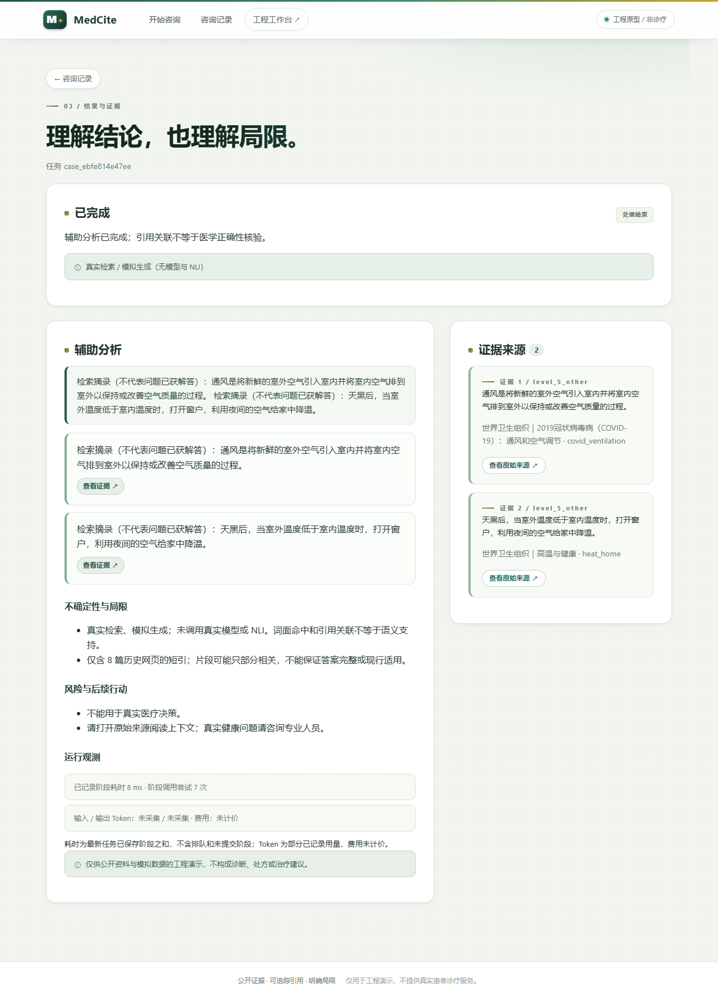
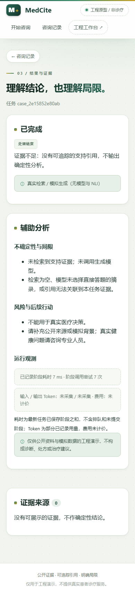
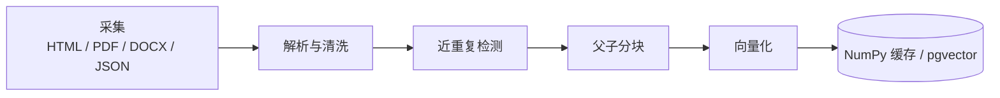
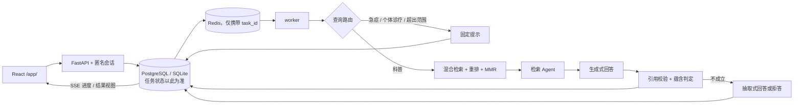

# MedCite

可溯源的健康问答原型。系统从多来源公开医学资料中检索证据，回答的每一句都带引用，引用必须逐字出自原文；证据不足、问题超出范围或涉及个体诊疗时拒答。

[](https://github.com/control-coder/medcite/actions/workflows/ci.yml)


> [!IMPORTANT]
> 本项目是工程原型，只处理公开资料与模拟输入，不提供诊断、处方或治疗建议，也不接收真实患者数据。

## 简介

用户提交一个健康相关的问题，系统先判断问题类型：急症直接提示拨打 120，个体诊疗（诊断、剂量、停药）和与健康无关的问题给出固定说明，科普问题进入检索。检索在约 4 万个分块上做混合检索和重排，由检索 Agent 决定是否改写、拆分问题或扩展上下文，再生成带句子级引用的回答。每句回答都经过代码校验和蕴含判定，不成立的句子不展示；整体不成立时改为抽取式回答（直接展示原文摘录），仍不成立就拒答。

整个流程由后台 worker 执行，任务状态以数据库为准，前端通过 SSE 实时显示进度。

## 核心能力

- **多来源语料处理**：采集世界卫生组织事实清单与出版物、国家卫生健康委文件、中国疾控中心疫情月报、中文维基百科共 5 类 498 份公开资料，格式包括 HTML、PDF、DOCX、表格和 JSON。解析后清洗、用 MinHash 做近重复检测，再做父子分块（parent-child chunking）：小块用于检索，所在段落作为上下文交给模型。共 39,752 个子块、20,701 个父块。
- **向量存储与增量同步**：向量本地持久化缓存，也可存入 pgvector（HNSW 索引）；按内容哈希增量同步，只为新增和改动的文档重新编码。有缓存时启动从 21.5 s 降到 1.0 s。
- **检索**：查询路由与元数据过滤（来源类型、统计周期）→ 混合检索（BM25 + 向量，RRF 融合）→ 交叉编码器重排 → MMR 去冗余。
- **检索 Agent**：基于 Function Calling 的多工具检索，支持 HyDE、问题拆分后并行检索、扩展上下文，参照 CRAG 对检索结果分级后决定下一步；有调用次数和时间预算，出错时回退到固定检索流程。
- **生成式回答与引用校验**：每句 1–2 条引用，引用片段必须逐字出自本轮证据，句中数值必须出现在引用中，不允许出现剂量与诊断表述；再由模型做蕴含判定，判为不蕴含的句子不展示。
- **任务一致性**：任务状态机、幂等键去重、乐观锁、worker 租约与续约、阶段结果落库后可断点续跑、定时补发未送达的队列消息。
- **用户隔离**：服务端签发匿名会话，每个用户只能访问自己的数据，访问他人或不存在的数据一律返回 404。
- **成本与可复现**：真实模型调用经过持久化预算账本，先扣额度再发请求；所有调用的请求与响应都录制为调用记录（cassette），评测和 CI 可以不联网回放。

## 评测结果

评测集共 262 条查询，按来源和意图分层划分为开发集 60 条、测试集 202 条。相关性在句子级由 LLM 标注（16,140 个句子），与早期标注的一致率 0.921，Cohen's kappa 0.836。所有参数只在开发集上选择，测试集只运行一次。结果不代表医学准确率，也不代表真实用户的问题。

测试集中可回答的科普问题 129 条、无答案的科普问题 26 条、急症问题 6 条，模型为 `mimo-v2.6-flash`：

| 指标 | 基线 | 完整链路 · 抽取式回答 | 完整链路 · 生成式回答 |
| --- | --- | --- | --- |
| 正确回答（/129） | 104（80.6%） | 108（83.7%） | 118（91.5%） |
| 过度拒答（/129） | 23 | 12 | 8 |
| 无答案被作答（/26） | 2 | 3 | 4 |
| 急症给出急症提示（/6） | 0 | 6 | 6 |
| 引用召回率 / 引用精确率 / 忠实度 | — | — | 0.877 / 0.854 / 0.914 |
| 时延 p50 / p90（s） | 16.7 / 35.9 | 27.2 / 74.4 | 31.6 / 82.2 |

- **基线**：向量检索 + 重排 + 只会改写查询的单工具检索 Agent，使用同一份语料。完整链路是上面「核心能力」中的全部检索与回答环节。
- **生成侧指标**：引用召回率、引用精确率按 ALCE 的定义，忠实度按 RAGAS 的定义，由 LLM 评审给出。评审本身用 100 对程序构造的样本检查过：改数字、增删否定词、换成无关引用这几类错误的识别率在 0.92 到 1.0 之间，正确样本无误判。
- **急症**：急症问题在三种条件下都没有被作答；完整链路 6/6 给出就医提示。
- **查询路由**：测试集评测之后又调整过一次路由提示词，开发集上科普问题被错误拒答从 9 条降到 2 条。上表的测试集数字基于调整前的提示词，没有重跑。
- **可靠性**：60 个病例、4 个 worker 进程，随机强制终止 8 次并暂停 2 次，SQLite 与 PostgreSQL 各跑 3 个随机种子，全部 180/180 成功，结果恰好提交一次。
- **端到端**：真实模型经 HTTP、数据库与独立 worker 完整跑通科普、急症、个体诊疗各 1 题，跨会话访问均返回 404。

早期在 131 篇 WHO 网页、168 条查询上对 BM25、向量检索、查询改写、检索 Agent、重排和多轮追问的逐项对比，以及方法、复现命令和原始报告，见 [评测与验证](docs/evaluation.md)。

## 截图

截图由浏览器自动测试生成，使用离线演示模式，重新生成的方法见 [开发与运行](docs/development.md)。

结果与证据页：每条摘录都标明出处，右侧列出原始来源，可打开原文。



手机宽度下的拒答：问题与语料无关时检索不到证据，页面显示“证据不足”。



## 架构

离线语料处理：



在线问答：



设计取舍、一致性保证和已知限制见 [架构与取舍](docs/architecture.md)。

## 快速开始

环境要求：Python 3.11、Node.js 20.19+。离线演示不需要 Docker、模型下载或 API Key，使用仓库内置的 WHO 科普摘录与 BM25 检索。

```bash
# 1. 安装依赖
conda env create -f environment.yml
conda activate medidiag
python -m pip install -e ".[dev]"
npm ci --prefix frontend
npm run build --prefix frontend

# 2. 使用独立的演示数据库并完成迁移
mkdir -p .cache/demo
export DATABASE_URL="sqlite:///./.cache/demo/public-demo.db"
export HF_HUB_OFFLINE=1 TRANSFORMERS_OFFLINE=1
python -m alembic upgrade head

# 3. 启动（API + 本地 worker 线程）
python -m medidiag.cli demo --provider retrieval_mock --app-config configs/application.yaml --port 8400
```

打开 <http://127.0.0.1:8400/app/>，点击“填入公开检索示例”并提交。Windows PowerShell 下用 `$env:DATABASE_URL = "..."` 设置环境变量。

### 运行完整链路

完整链路的语料全文只保存在本机，需要先按来源清单重建；向量模型 `BAAI/bge-small-zh-v1.5` 与重排模型 `BAAI/bge-reranker-v2-m3` 须已在本地缓存，应用不会自动下载。

```bash
# 采集、解析、分块、向量同步
python scripts/corpus_fetch.py --sources examples/public_health_v4/sources.json
python -m medidiag.cli corpus ingest --sources examples/public_health_v4/sources.json
python -m medidiag.cli corpus chunk --parsed .cache/corpus/parsed/documents.jsonl --strategy parent_child --out .cache/corpus/chunks/parent_child/
python -m medidiag.cli corpus sync --app-config configs/application_v4_recommended_generative.yaml

# 生成式回答（需要在 .env 中配置 MIMO_API_KEY、MIMO_BASE_URL）
python -m medidiag.cli demo --provider mimo_grounded --app-config configs/application_v4_recommended_generative.yaml --live-budget .cache/ledger.db --port 8400
```

抽取式回答使用 `configs/application_v4_recommended.yaml`。每个预算账本最多允许 8 次真实调用，一个科普问题约用 5 次。PostgreSQL + Redis/Celery 服务模式、各运行模式与排障见 [开发与运行](docs/development.md)，语料来源、许可与处理细节见 [语料数据卡](examples/public_health_v4/README.md)。

## 测试

```bash
ruff check .
mypy src
python -m pytest -q
python scripts/verify_offline.py --provider retrieval_mock --browser   # 端到端：独立 API/worker 加浏览器
```

CI 在每次推送到 `main` 和每个 Pull Request 上运行三个作业：`check`（ruff、mypy 严格模式、pytest）、`eval-regression`（不联网回放调用记录并运行回归检查，误答必须为 0，见 [examples/rag_regression](examples/rag_regression/README.md)）、`e2e`（真实 API、独立 worker 和 Chromium）。

## 目录结构

```text
src/medidiag/
  api/            HTTP 接口、匿名会话、结果视图、SSE 进度
  workflow/       状态机、任务租约、派发补偿、worker、查询路由、检索 Agent、生成式回答
  rag/            BM25、向量与混合检索、重排、证据包；ingest/ 解析清洗分块，store/ 向量存储
  review/  compliance/   复核与输出合规边界
  llm/            模型适配、预算账本、调用记录与回放
  db/  observability/    数据模型、会话、结构化日志与追踪
frontend/         React + TypeScript + Vite 应用与 Playwright 测试
migrations/       Alembic 数据库迁移
configs/          应用运行配置
examples/         语料来源清单、评测查询与标注、回归集
scripts/          语料采集、数据准备、故障注入与端到端验证脚本
eval/             评测代码与调用记录
artifacts/        评测报告
tests/            自动化测试
```

内部 Python 包、conda 环境和数据库沿用早期名称 `medidiag`。

## 文档

| 文档 | 内容 |
| --- | --- |
| [架构与取舍](docs/architecture.md) | 数据权威、任务一致性、用户隔离、检索与回答链路、选型依据 |
| [API 与前端行为](docs/api.md) | 接口、输入约束、结果视图、SSE 与失败语义 |
| [开发与运行](docs/development.md) | 安装、各运行模式、验证命令与排障 |
| [评测与验证](docs/evaluation.md) | 指标口径、数据集、检索与生成评测、可靠性、错误分析、未验证范围 |
| [评测代码说明](eval/README.md)、[报告索引](artifacts/reports/README.md) | 评测脚本、调用记录与报告说明 |

## 局限

- 引用校验和蕴含判定只能说明回答有原文支持，不代表医学正确；蕴含判定和评审都由模型完成，评审与被评系统是同一个模型。
- 相关性标注由 LLM 完成，未经人工复核；每个条件只运行一次，样本量小，不做显著性结论。无答案被作答只有 2–4 条，条件之间的差别不可靠。
- 2 份 .doc 格式的国家文件因本机缺少转换工具未入库；维基百科内容未经专业审核，只作为低权威来源。
- 离线演示默认使用 BM25 与内置的小规模摘录；完整链路需要本机重建语料并准备模型缓存，每个问题需要多次模型调用，时延在 30 秒左右。
- 真实模型经数据库 worker 的端到端只验证了 3 题；pgvector 下的元数据过滤、PostgreSQL 与多 worker 下的 SSE、浏览器内点击引用高亮尚未验证。
- 匿名会话不支持账号找回和跨设备迁移；公网部署、多机容量和临床效果都没有验证。

## 许可证

本项目代码采用 [MIT License](LICENSE)。第三方组件与数据（HTMX、世界卫生组织资料、中文维基百科等）的来源和使用条件见 [THIRD_PARTY_NOTICES.md](THIRD_PARTY_NOTICES.md)。
