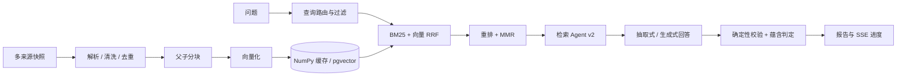

# 架构与设计取舍

MedCite 采用模块化单体 + 独立 worker 的结构。本文说明核心设计、一致性保证和已知限制；接口字段见 [API 文档](api.md)，启动方式见 [开发与运行](development.md)。

```mermaid
flowchart LR
    U[React /app/] --> API[FastAPI 单体]
    H[/assistant 与 /demo] --> API
    API --> ID[服务端匿名会话与 owner 过滤]
    ID --> DB[(PostgreSQL 权威状态)]
    D[数据库派发与补偿扫描] --> DB
    D --> R[(Redis 仅携带 task_id)]
    R --> C[Celery 消费者]
    C --> W[共用执行器：状态机 / CAS / 租约]
    L[CLI worker 或 demo 线程] --> W
    W --> DB
    W --> P[显式选择的 Provider]
    P --> F[fake_offline 固定 fixture]
    P --> B[纯 BM25 中文双字检索]
    B --> M[retrieval_mock 确定性摘录]
    B --> G[mimo_grounded 有界真实 LLM 摘录]
    DB --> O[用户安全投影与证据关联]
    O --> U
    E[eval 评测代码] --> A[端到端评测与检索基准]
    E -. 回放调用记录 .-> G
```

所有入口共用同一套执行逻辑，但支持的模式不同：Celery 消费者目前只配置离线模式；真实模型模式通过带预算账本的 CLI 入口运行。最简 `demo` 命令使用 SQLite 并附带本地 worker 线程。

## 数据权威与任务一致性

- `Case` 保存 owner、状态、版本号与当前任务；`WorkflowTask` 保存 attempt、租约、领取者与错误码；`StageArtifact`、`CaseReport`、`CaseEventLog` 保存阶段输出、版本化报告与事件。
- 创建与启动的幂等键按服务端 owner 隔离。队列消息只是唤醒信号：即使 `lease_owner` 相同，也必须重新通过 CAS 领取，不能凭重复消息重入有效租约。
- 数据库提交与消息发布不是原子操作。扫描器默认每 5 秒、每批最多 100 条，检查 `PENDING` 任务和租约过期的 `RUNNING` 任务并重新派发。系统接受重复投递，不承诺 exactly-once。
- 调用 Provider 前结束读事务，返回后重新校验 owner、attempt 与租约（fencing）。worker 中断后从已提交阶段恢复，达到恢复上限后升级为 `ESCALATED`，不无限重试。
- 取消在同一事务内终止病例并使任务失效，之后的迟到写入会被拒绝。取消无法撤回已经发出的远程请求。

**取舍**：对单人维护的原型，本地事务足以表达核心一致性，独立 worker 已隔离耗时处理。在没有容量或组织边界需求时不拆微服务；扫描补偿已覆盖现有故障场景，因此不再同时维护 outbox、Kafka 或复杂缓存。

## 用户归属与安全投影

`WebSession` 保存随机凭据的摘要、服务端 owner 与到期时间，不接受客户端自报归属。匿名身份只保证隔离，不提供实名、找回或跨设备迁移；没有归属的历史数据不会分配给首个访问者。

前端只在路由中保存任务 ID，内容全部从后端恢复。结果投影只显示能关联到本任务证据的 claim，摘要也只由保留下来的 claim 组成，避免隐藏无引用正文后仍通过自由摘要泄露结论。原始报告保留用于受控排障。

## 检索与模型路线

| 路线 | 检索与生成 | 审核与限制 |
| --- | --- | --- |
| `fake_offline` | 固定证据和确定性 fixture | 只验证工程流程 |
| `retrieval_mock` | 默认纯 BM25、中文按相邻两字切分；也可选向量检索方案（见下）；固定规则摘录原文 | 引用结构关联与 ComplianceGuard；非 NLI 语义审核 |
| `mimo_grounded` | 同一检索；`mimo-v2.6-flash` 以 JSON 选择完整原文，没有直接答案时拒答 | 二次原文校验与 ComplianceGuard；非医学语义审核 |

应用配置在加载时校验，只接受两种明确的检索方案：默认的单路 BM25（`configs/application.yaml`，不需要下载模型），或单路向量检索（`configs/application_dense.yaml`：固定模型 `BAAI/bge-small-zh-v1.5` 的固定版本，只读本地缓存，缓存不存在就报错而不是自动下载，语料为 51 篇页面、178 个片段的 v2）。混合检索（v4 配置除外，见下文「v4 RAG 链路」）、重排、浮动版本、允许联网下载、套用研究配置或关闭泄露检查都会被拒绝，也不会因为 `.env` 中存在密钥就切换到在线模式。选型依据见下文。检索为空时在生成前拒答；字面命中但片段里没有答案的情况仍会出现，这类问题依赖模型或摘录层拒答，系统不保证识别所有证据不足的问题。

真实模型模式最多接受三条 claim，每条必须逐字复制本次某个 chunk 的完整原文并绑定该 chunk。改写、拼接、重复、未知引用、状态矛盾、格式错误、返回模型不符、缺少响应 ID 或输出被截断均会被拒绝。预算账本使用持久化 SQLite：先占额度后发请求，失败不退额，重启不重置，不跟随重定向，也不保存思维链。

**取舍**：合法的引用 ID 只证明可追溯，完整原文校验也不保证相关性或医学适用性。中文应用不借用英文 NLI 模型为结论背书。在小语料上保留漏检、误命中与保守拒答，比堆叠未经验证的多 Agent 链路更符合原型的定位。

### 选型依据

下表数字为 v3 语料测试集（可回答 56 条，不可回答 28 条）的结果，详见评测文档的 [L1 检索层矩阵](evaluation.md#三l1-检索层矩阵) 和 [L3 端到端矩阵](evaluation.md#五l3-端到端矩阵)。标注 v2 的数字来自旧语料。

| 选项 | 依据 | 结论 |
| --- | --- | --- |
| 向量检索与 BM25 | Hit@3 为 0.929 对 0.679；端到端正确作答 52 对 36（/56）；Hit@3 差值的置信区间为 [0.125, 0.375]，p = 0.0005 | 有本地向量模型缓存时选向量检索 |
| 混合检索 | 与向量检索的 Hit@3 完全相同（52/56），MRR@10 只差 0.009，没有可检验的差异 | 不接入，避免多维护一个权重 |
| 查询改写 | BM25 下 Hit@3 从 0.679 提高到 0.875，改述提问类从 5/21 提高到 16/21；向量检索下在 v2 上只从 54/56 提高到 55/56（一次性计算，脚本未入库） | 只对 BM25 有用，作为可选配置；向量检索下不启用 |
| 检索 Agent | 与固定的查询改写相比，BM25 下命中相关片段的数量都是 92 条，端到端 44 对 46；向量检索加 Agent 只多正确作答 2 条（p = 0.5），每题多约 1.8 次模型调用 | 没有明显收益，不作为默认配置 |
| 按得分阈值拒答（v2） | 向量检索加开发集阈值：误答率 0.25，过度拒答率 0.18；由模型拒答：误答 0/28 | 不采用。得分区分不了“主题相同但没有答案”的问题（近似主题类仍有 5/11 被回答） |
| 输出被拦截后的处理 | v2.5 上 33 次首次被拦截，带反馈重试恢复 30 次，不带反馈重新提问恢复 23 次，p 约 0.09 | 带反馈重试一次 |

按得分阈值拒答的实验，以及用逻辑回归预测是否作答的尝试，保留在 git 历史的早期评测文档中，没有进入应用。v3 上对推荐配置重新做了取舍曲线（重排分数门槛，见评测文档第五节）：模型拒答已经没有观测到误答，门槛只增加过度拒答，结论不变。结论的适用范围见评测文档第九节。

### 向量存储与增量同步

向量检索与混合检索的配置可加 `retrieval.vector_store`，取值 `numpy` 或 `pgvector`；不写则保持原有行为（每次启动重新编码，BM25 仍每次在内存重建，不做序列化）。代码在 `src/medidiag/rag/store/`。

- `numpy`：向量与元数据按 `{corpus_hash}_{model_revision}` 存到 `.cache/index/`（`.npy` 加 `.json`）。同一语料与模型版本第二次启动直接读文件，不重新编码；语料或模型版本变化则换一个文件重新编码。适合 SQLite 演示和测试。
- `pgvector`：表 `kb_documents`、`kb_chunks`（含 `embedding vector(512)`，HNSW 索引 m=16、ef_construction=64，余弦距离），由 Alembic 迁移 `f5b8d3a1c6e2` 创建，仅 PostgreSQL 执行，SQLite 跳过；`compose.yaml` 的数据库镜像为 `pgvector/pgvector:pg17`。连接串从环境变量 `MEDIDIAG_PGVECTOR_DSN` 读取。启动时不会自动写库，须先同步，缺块时报错。元数据过滤用参数化 SQL（`metadata ->> key = ANY(values)`）。
- `medidiag corpus sync [--app-config ...] [--store numpy|pgvector]`：按文档 `content_hash` 判断新增、变更、删除，只为新增和变更的文档重新编码。变更文档的旧块和被删除文档的块标记为 `retired`，不物理删除，历史证据包里的 `chunk_hash` 仍可回查；有变更时 `corpus_version`（整数）加 1，无变化不编码也不升版本。检索只返回 `active` 块。

局限：`embedding vector(512)` 固定对应 `bge-small-zh-v1.5`，换更高维度的模型要新增迁移；块只在文档级别增量，文档内未变的块也会随文档整体重算。

### 多轮追问

追问是一个带 `parent_case_id` 的新病例，状态机和阶段不变。worker 在检索阶段沿上一轮取最近 3 轮历史，只接受同一归属的病例。provider 提供 `retrieve_in_context` 且配置开启 `generation.context_rewrite` 时，先调用一次模型（提示词 `context-rewrite-v1`），输出 `{"standalone_question": ...}`：只用历史中的名称补全代词和省略，不回答、不添加事实；格式不符、超长、出现历史与问题里都没有的数字或模型出错时回退到原问题。补全后的问题同时用于检索（检索 Agent 与按原问题重排里的“原问题”即补全后的问题）和生成。

**取舍**：生成步骤只看补全后的问题，不看历史。上一轮的回答不是本轮证据，交给生成会让模型有机会引用历史而不是本轮原文；补全只改变“问的是什么”，摘录必须等于本轮片段全文、证据不足时拒答的规则不变。单轮问题不经过补全，请求与原来逐字相同，已有调用记录照常回放。配置为 `configs/application_dense_agent_rerank_multiturn.yaml`，代码见 `src/medidiag/workflow/context_rewrite.py`。

## v4 RAG 链路

v4 链路通过新配置开启（`configs/application_v4_*.yaml`，推荐组合为 `application_v4_recommended.yaml` 与 `application_v4_recommended_generative.yaml`），不改变现有 7 个配置的行为。三种运行模式仍互不静默切换。



| 环节 | 模块 |
| --- | --- |
| 解析、清洗、去重、分块 | `rag/ingest/`（`document.py`、`html.py`、`pdf.py`、`docx.py`、`table.py`、`clean.py`、`dedup.py`、`chunking.py`） |
| 向量存储与增量同步 | `rag/store/`（`VectorStore` 协议、`NumpyStore`、`PgVectorStore`、sync） |
| 元数据与过滤值校验 | `rag/metadata.py` |
| 混合检索（RRF、MMR） | `rag/hybrid.py` |
| 检索结果缓存 | `rag/cache.py` |
| 查询路由 | `workflow/query_router.py` |
| 检索 Agent v2 | `workflow/retrieval_agent_v2.py` |
| 生成式回答 | `workflow/generative_answer.py` |
| 进度推送（SSE） | `api/app.py` 的 `GET /api/v1/cases/{id}/events/stream` |

关键取舍：

- **过滤只应用 `source_type` 与 `period`**：路由抽取的 `section_type` 与 `topic` 只记录、不应用。M10 在 v4 dev 上的对比中，预测的全部过滤使可回答科普的 Hit@3 从 30 降到 15，只用 `source_type` + `period` 为 25，仍低于不过滤的 30。评测标注池来自不过滤检索，过滤侧被低估，所以结论是「保守应用」，不是「过滤无效」。过滤值必须属于已知枚举，候选不足时按固定顺序放宽重查并记录。
- **生成式回答的校验与降级顺序**：模型输出先经确定性规则（chunk_id 属于本轮证据、quote 是证据逐字子串、句中数值出现在引用中、剂量指令与诊断断言句拒绝；否定词不一致标记为可疑），失败时按 `on_invalid` 至多重试一次；通过后由一次批量蕴含判定（提示词不含用户问题）。不蕴含的句子不展示，部分蕴含的句子带标记展示；全部句子被删时降级为抽取式回答，抽取式也不成立则拒答。空证据不调用模型。
- **蕴含失败视同不展示**：蕴含调用出错、返回非法 JSON 或字段名不合契约时，整批句子按未核实处理并走降级，而不是放行。代价是偶发的可用回答被降级（M13 的 33 次评审中有 2 次不可用）。
- **缓存存快照且默认关闭**：`retrieval.cache` 是进程内 LRU（TTL 1 小时），键含规范化问题、过滤条件、`corpus_hash`、`corpus_version` 与 `config_hash`，值是证据快照而不只是 chunk_id 与分数，保证命中与未命中的证据逐字一致。不缓存模型回答，因为多轮上下文和用户背景各不相同。该开关不计入 `config_hash`，默认关闭。
- **SSE 沿用 owner 校验**：流开始前按与轮询端点相同的规则校验归属，越权与不存在统一 404；流内每轮用独立会话重新校验。事件来自已有的事件日志，服务端 0.5 秒轮询事件表后转发，没有新增消息通道；前端连接失败时回退为轮询。不做逐 token 流式输出，因为生成式回答要整段校验后才能展示。
- **白名单只扩展**：`workflow/application.py` 的配置校验为新字段（`vector_store`、`hybrid`、`query_router`、`agent_version`、`answer_mode`、`cache`）增加了显式的合法取值，没有放宽对浮动版本、联网下载、套用研究配置、关闭泄露检查的拒绝。

未验证：真实 `mimo_grounded` 经数据库 worker 的完整端到端、pgvector 下的元数据过滤路径、PostgreSQL 与多 worker 下的 SSE、浏览器内点击引用高亮。蕴含判定是模型给出的「引用是否支持这句话」，不是医学正确性审核。评测数字见 [评测文档](evaluation.md#v4-评测汇总m15)。

## 观测

结果页展示已保存阶段的耗时、Provider 调用次数与返回的 Token 用量。它们不是完整的端到端计费数据；未核实计价时费用显示为未知，而不是零。单次耗时不外推为吞吐或稳定的 P95。

## 未实现的范围

账号恢复与历史数据认领、公网生产部署（TLS、运维平台）、多机容量测试与临床效果评估均不在当前范围内。`/demo` 中的人工处置是工程升级操作，不是临床专家审核。
